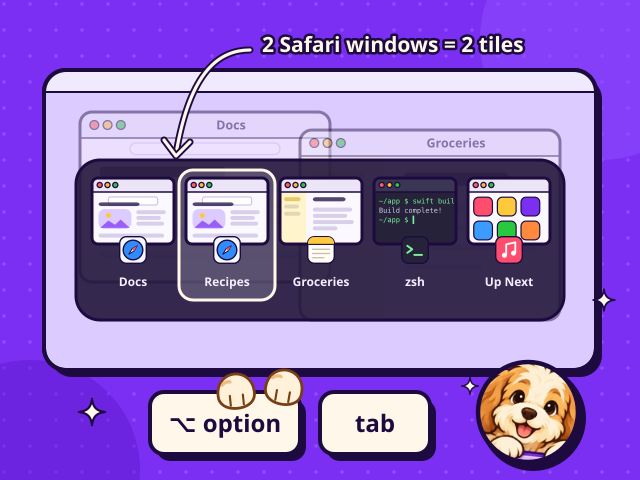
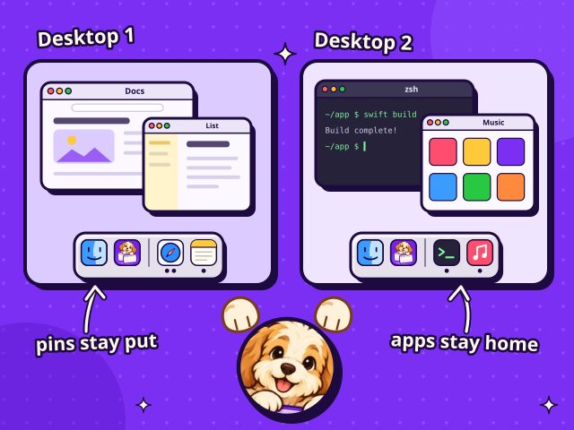
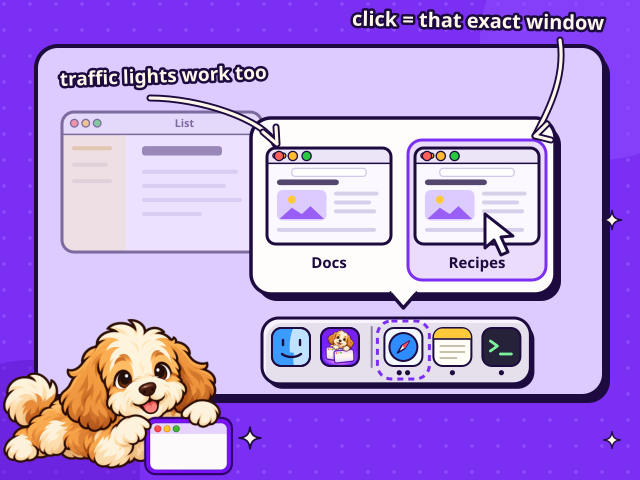
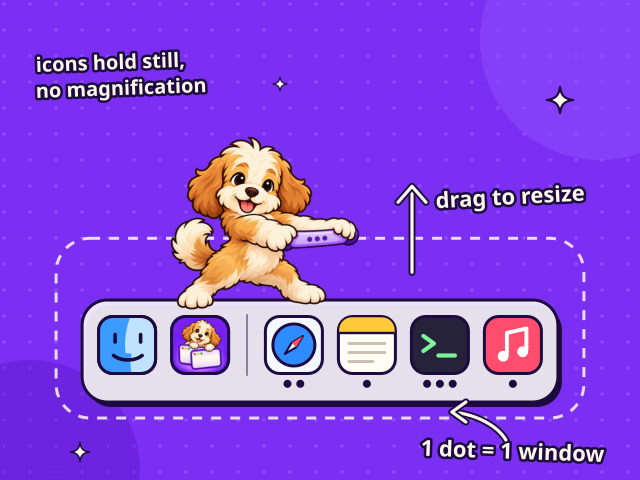

# DogBar

A native macOS Dock and window switcher for people with a lot of windows open. Switch to an individual window, preview it from the Dock, and give each desktop its own workspace.

[Website](https://dogbar.hristijan.dev/) · [Features](#features) · [Build and run](#build-and-run) · [Testing](#testing) · [Distribution](#distribution)

**Status:** active development. There is no public signed and notarized download yet. DogBar needs Accessibility and Screen Recording permissions to run its window-management features.

## Features

- **Switch windows with Option+Tab.** Each window gets its own thumbnail, including multiple windows from the same app. Hold Option, tap Tab, then release to focus the selection. Shift reverses direction, arrows navigate, and Escape cancels.
- **Keep desktops separate.** Show apps with windows on the current desktop, while keeping your pinned apps available everywhere. The Dock, switcher and previews each have their own scope setting.
- **Preview before switching.** Hover an app to see its windows, then choose the exact one you want. Traffic-light controls close, minimize or toggle fullscreen for that window. Previews also work with Apple's native Dock.
- **Count open windows.** Window-count dots show how many windows an app has in the selected scope, with configurable styles and limits.
- **Resize the Dock directly.** Drag its divider grip inward to enlarge it or outward to shrink it. Icons keep a fixed size on hover. Bottom, left and right placement, autohide, pinning and app rules are configurable.
- **Change settings live.** Open Settings from the monochrome paw in the menu bar or the app icon. Pause and Restore Native Dock bring back the original Dock preferences.

### Feature illustrations

These illustrations come from the DogBar website.

**One tile per window**



<details>
<summary>See desktop, preview and Dock illustrations</summary>

**A Dock for each desktop**



**Choose a window from its preview**



**Window counts and resizing**



</details>

## Build and run

### Requirements

- A Mac with Xcode and a Swift 6 toolchain. Development and release tooling are currently checked on Apple Silicon.
- The app targets **macOS 14 or newer** and uses Swift 5 language mode.
- The native app uses Apple frameworks only. No third-party packages are required.

### Get the code

```sh
git clone https://github.com/KIKOmanasijev/DockWindow.git
cd DockWindow
```

The repository is currently private, so cloning requires access.

### Build, install and launch

```sh
Scripts/run.sh
```

This builds the release executable, assembles and signs the app bundle, installs it at `~/Applications/DockWindow.app`, then launches it. If an existing instance is running, installation waits for it to quit and restore the native Dock.

To compile the Swift package without installing or launching it:

```sh
swift build
```

To build and install the bundle without launching it:

```sh
Scripts/build-app.sh
```

### Set up permissions

Use the app's onboarding window or **Settings > General** to request:

- **Accessibility:** window focus, window controls and keyboard shortcuts.
- **Screen Recording:** window thumbnails and hover previews.

After enabling them in System Settings, use **Relaunch DogBar** if access is still inactive. The app checks effective process access and enables its features only after both permissions are available.

### Keep development signing consistent

For local development, create a certificate named **DockWindow Dev** in **Keychain Access > Certificate Assistant > Create a Certificate...**. Choose **Self Signed Root** and **Code Signing**. Certificate Assistant is in the app's menu at the top of the screen.

The build script uses that signing identity when present. Without it, the script falls back to ad-hoc signing, which can invalidate permission grants when the binary changes. After switching signing identities, macOS may require permission approval again.

The development certificate is for local builds. Public distribution uses the separate Developer ID workflow described below.

<details>
<summary>Why do some paths and identifiers still say DockWindow?</summary>

DogBar is the product and app display name. Its bundle ID `com.dockwindow.app`, executable `DockWindow`, development install path `~/Applications/DockWindow.app`, settings keys and `DockWindow Dev` certificate name remain unchanged to preserve existing identity and local state. The Swift package and GitHub repository also retain their existing names.

</details>

## Testing

Run the native unit tests:

```sh
swift test
```

They cover window ordering, desktop filtering, Dock composition and click decisions, window indicators, resizing, hotkey handling, settings, preview geometry and failure handling.

Run the release-tool tests with Python 3:

```sh
python3 -m unittest discover -s Tests/ReleaseTests -v
```

These test release validation and publishing gates using fixtures and mocked Apple tools. Passing them does not mean an artifact has been signed or notarized.

The landing page is static HTML, CSS and JavaScript, with no package installation or build step. With Node.js available, check its runtime scripts:

```sh
node --check landing/script.js
node --check landing/release.js
node --test 'landing/tests/*.test.cjs'
```

The website tests cover release validation and demo interactions. DOM tests skip when `jsdom` is unavailable. To run those too, set `JSDOM_PATH` to an existing local `jsdom` package directory before running the test command.

Window focus, Spaces, permissions, native Dock restoration and performance also need testing on a real Mac. See the [verification status](Docs/Verification.md) and [manual test checklist](Docs/Milestones.md).

## Distribution

A public DMG needs an Apple-issued **Developer ID Application** certificate, hardened-runtime signing, notarization and stapled tickets. Enrollment in the Apple Developer Program is required before this project can produce that release.

The [distribution guide](Docs/Distribution.md) explains owner setup, Keychain credentials, building, verifying and staging a versioned DMG. The release tools reject development or ad-hoc signing and do not modify the installed development app. Website downloads stay unavailable until a verified release is staged.

## Project layout

| Path | Purpose |
| --- | --- |
| `Sources/DockWindow/` | App startup, lifecycle, menus and onboarding |
| `Sources/DockWindowCore/` | Window tracking, system services, feature UI and testable policies |
| `Tests/DockWindowCoreTests/` | Native unit tests |
| `Tests/ReleaseTests/` | Release-tool tests |
| `Scripts/` | Development builds and public-release tooling |
| `Resources/` | Bundle metadata, icon and entitlements |
| `landing/` | Website, feature illustrations and interactive demo |
| `Docs/` | Architecture research, verification and distribution instructions |

## Current limitations

- Private macOS APIs load at runtime and can become unavailable. Cross-desktop window discovery is bounded, and app assignments or fullscreen behavior can defeat new-window placement requests.
- Protected, minimized or other-desktop windows may need a cached thumbnail or icon placeholder.
- The replacement Dock cannot reserve screen space. Minimize animations target the hidden native Dock, and app-specific third-party Dock menus are unavailable.
- Older SDKs use a material approximation for the Dock background. Native Liquid Glass needs a newer SDK. Visual parity and performance budgets remain under verification.

DogBar saves the original native Dock preferences before hiding it and restores them on disable, Pause and Quit. After a crash, recovery runs on the next launch. Preserve application defaults while recovery is pending.

Implementation research and source references are in [PrivateAPIReference.md](Docs/PrivateAPIReference.md). The app was independently implemented from behavior and API facts without copying GPL implementation bodies.
