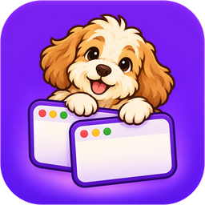
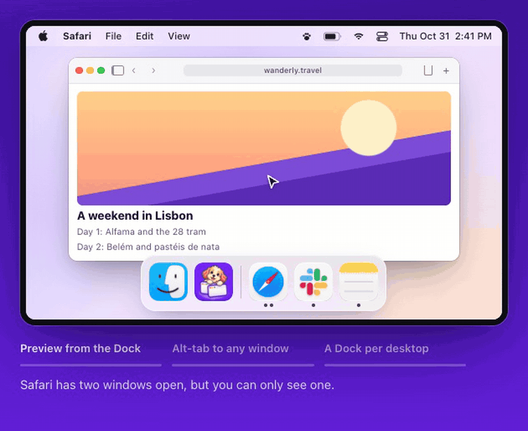
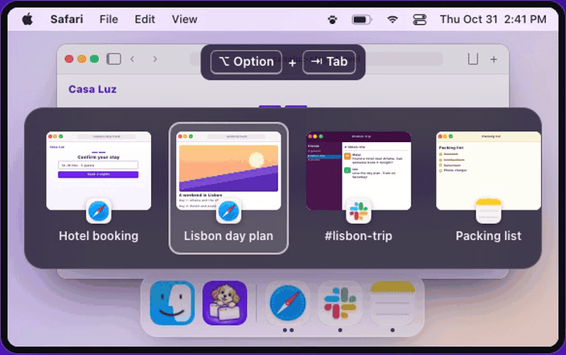
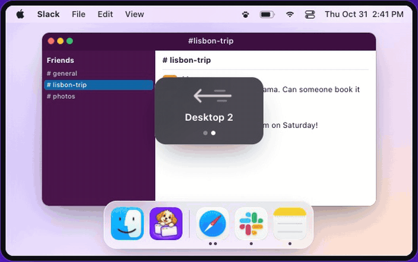

<p align="center">
  
</p>

<h1 align="center">DogBar</h1>

<p align="center">
  <strong>Window management your Mac should have shipped with.</strong><br>
  A better alt-tab and Dock for macOS 14 and later.
</p>

<p align="center">
  <a href="https://dogbar.hristijan.dev/">Website</a> ·
  <a href="https://dogbar.hristijan.dev/#get">Download</a> ·
  <a href="#see-it-in-action">See it in action</a> ·
  <a href="#what-you-get">What you get</a> ·
  <a href="#install">Install</a> ·
  <a href="#build-and-run">Build from source</a> ·
  <a href="#license">License</a>
</p>

On a Mac, Cmd+Tab shows one icon per app, so two Safari windows look like one, and the Dock can’t tell you which window you’re about to get. DogBar fixes that. It shows you every window, lets you preview them from the Dock, and gives each desktop its own Dock.

> **Status: in active development.** An [unnotarized preview](https://dogbar.hristijan.dev/#get) is available for Apple Silicon Macs on macOS 14 or later. It is self-signed, not notarized by Apple, so macOS asks you to confirm the first launch.

## See it in action

**Hover an app in the Dock to preview its windows**, then click the one you want.



**Alt-tab to any window, not just any app.** Every window gets its own tile.



**Get a separate Dock on every desktop.** Swipe to another desktop and the Dock changes to match.




## What you get

- **See every window when you alt-tab, not just apps.** Hold Option and tap Tab. Every window gets its own tile with a preview and its name, including several windows from the same app.
- **Hover an app in the Dock to preview its windows.** Click the one you want and only that window comes up. You can close, minimize or make it full screen right from the preview.
- **Get a separate Dock on every desktop.** Each desktop’s Dock shows only the apps open there. Your pinned apps show up everywhere.
- **See how many windows each app has.** One dot per open window, right under the icon.
- **Resize the Dock by dragging its edge.** Icons stay still, with no magnifying. Size follows your drag directly, including when you reverse direction.
- **Keep Apple’s Dock if you prefer.** Native Dock mode leaves Apple’s Dock in place and still gives you window previews and the better alt-tab.

| | macOS | DogBar |
| --- | :---: | :---: |
| See a preview of every window when you alt-tab | ✗ | ✓ |
| Preview windows by hovering the Dock | ✗ | ✓ |
| A separate Dock for each desktop | ✗ | ✓ |
| See how many windows each app has | ✗ | ✓ |
| Close or minimize a window from its Dock preview | ✗ | ✓ |

A Dock per desktop and window dots need DogBar’s own Dock. Previews and the switcher work with either Dock.

## Install

1. Download the DMG from [dogbar.hristijan.dev](https://dogbar.hristijan.dev/#get). Check the SHA-256 shown next to the download if you like.
2. Open the DMG and drag DogBar into Applications.
3. Open DogBar. Because this preview is not notarized, macOS may block it the first time. Review the app, then go to **System Settings → Privacy & Security → Open Anyway**. Apple explains this in [Open a Mac app from an unknown developer](https://support.apple.com/102445).
4. Allow the two permissions DogBar asks for:
   - **Accessibility** lets it switch to, close and minimize single windows, and listen for its shortcut.
   - **Screen Recording** lets it show what’s inside each window in previews and the switcher.

   If a permission still looks inactive after you allow it, choose **Relaunch DogBar** in Settings.

## Using DogBar

| To do this | Do this |
| --- | --- |
| Switch to any window | Hold **Option**, tap **Tab**, let go of Option |
| Go back in the switcher | Add **Shift**, or use the arrow keys |
| Cancel the switcher | **Escape** |
| Preview an app’s windows | Hover its Dock icon |
| Bring up one window | Click its preview |
| Resize the Dock | Hover its inner edge or the divider grip, then drag |
| Open Settings | Click the paw in the menu bar, or the DogBar icon |
| Get your normal Dock back | Paw menu → **Pause DogBar** or **Restore Native Dock** |

In Settings you can choose whether the Dock, the switcher and previews each show windows from the current desktop or from all desktops. You can also move the Dock to the bottom, left or right, turn on autohide, pin apps and set app rules.

DogBar saves your original Dock settings before hiding Apple’s Dock and puts them back when you pause, restore or quit. If DogBar crashes, it restores them the next time it launches.

Apps without open windows and DogBar’s own Dock icon are hidden by default. Both options are available in **Settings → Dock**. The windowless filter applies to unpinned running and recent apps. Pinned apps stay available even with no open windows.

Maximized windows are adjusted to leave space above or beside the replacement Dock. This is enabled by default under **Settings → Dock → Keep maximized windows clear of the Dock**. Autohiding Docks and true full-screen windows are unaffected.

Dock previews can include a **+ New Window** tile (enabled by default). Optional CPU and RAM totals appear under the app name; enable them individually in **Settings → Dock Previews**. Usage is app-wide, including identifiable helper processes, and is sampled only while previews are visible. Windowless apps are hidden from Option+Tab by default; **Settings → Window Switcher → Show windowless apps** restores them.

## Updates

Choose **Check for Updates…** from the paw menu or the DogBar app menu. DogBar checks the website's release feeds, offers a newer compatible installer, verifies its SHA-256, and opens the DMG. Quit DogBar, drag the new copy into Applications, and reopen it. This first version does not replace the running app automatically. **About DogBar** shows the installed version, build revision and running path.

The same release feeds support future OTA distribution. Preview installers remain self-signed and unnotarized; no notarization or code-signature check is claimed by the updater itself. Public production builds still go through the release pipeline's signing and notarization checks. The existing public preview is older than this development build, so it will not be offered as an update.

## Build and run

### Requirements

- A Mac with Xcode and a Swift 6 toolchain. Development and release tooling are currently checked on Apple Silicon.
- The app targets **macOS 14 or newer** and uses Swift 5 language mode.
- The native app uses Apple frameworks only. No third-party packages are required.

### Get the code

```sh
git clone https://github.com/KIKOmanasijev/DockWindow.git
cd DogBar
```


### Build, install and launch

```sh
Scripts/run.sh
```

This builds the release executable, assembles and signs the app bundle, installs it at `~/Applications/DogBar.app`, then launches it. If an existing instance is running, installation waits for it to quit and restore the native Dock.

To compile the Swift package without installing or launching it:

```sh
swift build
```

To build and install the bundle without launching it:

```sh
Scripts/build-app.sh
```

### Set up permissions

Use the app's onboarding window or **Settings > General** to request:

- **Accessibility:** window focus, window controls and keyboard shortcuts.
- **Screen Recording:** window thumbnails and hover previews.

After enabling them in System Settings, use **Relaunch DogBar** if access is still inactive. The app checks effective process access and enables its features only after both permissions are available.

### Keep development signing consistent

For local development, create a certificate named **DockWindow Dev** in **Keychain Access > Certificate Assistant > Create a Certificate...**. Choose **Self Signed Root** and **Code Signing**. Certificate Assistant is in the app's menu at the top of the screen.

The build script uses that signing identity when present. Without it, the script falls back to ad-hoc signing, which can invalidate permission grants when the binary changes. After switching signing identities, macOS may require permission approval again.

The development certificate is for local builds. Public distribution uses the separate Developer ID workflow described below.

<details>
<summary>Moving from the old DockWindow build</summary>

Earlier builds were called DockWindow, with bundle ID `com.dockwindow.app`. Everything is now DogBar: the bundle ID is `dev.hristijan.dogbar`, the executable and targets are `DogBar` and `DogBarCore`, and the development install is `~/Applications/DogBar.app`. macOS ties permissions and saved settings to the bundle ID, so the first DogBar build asks for Accessibility and Screen Recording again and starts with default settings. `Scripts/build-app.sh` quits a running DockWindow first so it restores your Dock. Afterwards, delete `~/Applications/DockWindow.app` and its old entries in **System Settings → Privacy & Security**.

The local signing certificate keeps its name, `DockWindow Dev`, because it is an existing Keychain item. Renaming it means creating a new certificate.

</details>

## Testing

Run the native unit tests:

```sh
swift test
```

They cover window ordering, desktop filtering, Dock composition and click decisions, window indicators, resizing, hotkey handling, settings, preview geometry and failure handling.

Run the release-tool tests with Python 3:

```sh
python3 -m unittest discover -s Tests/ReleaseTests -v
```

These test release validation and publishing gates using fixtures and mocked Apple tools. Passing them does not mean an artifact has been signed or notarized.

The website in `landing/` is static HTML, CSS and JavaScript, with no package installation or build step. With Node.js available, check its scripts:

```sh
node --check landing/script.js
node --check landing/release.js
node --test 'landing/tests/*.test.cjs'
```

The website tests cover download and release validation, page structure and the demo walkthrough. DOM tests skip when `jsdom` is unavailable. To run those too, set `JSDOM_PATH` to an existing local `jsdom` package directory before running the test command.

Window focus, Spaces, permissions, native Dock restoration and performance also need testing on a real Mac. See the [verification status](Docs/Verification.md) and [manual test checklist](Docs/Milestones.md).

## Distribution

The current download is an **unnotarized, self-signed preview**. The [preview guide](Docs/PreviewDistribution.md) covers its build, checks and first-launch instructions. Preview DMGs are hosted on the DogBar website and mirrored on [GitHub Releases](https://github.com/KIKOmanasijev/DockWindow/releases); see [Releasing.md](Docs/Releasing.md).

A notarized release needs an Apple-issued **Developer ID Application** certificate, hardened-runtime signing, notarization and stapled tickets. Enrollment in the Apple Developer Program is required before this project can produce that release.

The [distribution guide](Docs/Distribution.md) explains owner setup, Keychain credentials, building, verifying and staging a notarized DMG. That workflow rejects development or ad-hoc signing. Preview tooling stays separate, and neither workflow modifies the installed development app.

## Project layout

| Path | Purpose |
| --- | --- |
| `Sources/DogBar/` | App startup, lifecycle, menus and onboarding |
| `Sources/DogBarCore/` | Window tracking, system services, feature UI and testable policies |
| `Tests/DogBarCoreTests/` | Native unit tests |
| `Tests/ReleaseTests/` | Release-tool tests |
| `Scripts/` | Development builds and public-release tooling |
| `Resources/` | Bundle metadata, icon and entitlements |
| `landing/` | Website ([dogbar.hristijan.dev](https://dogbar.hristijan.dev/)) with its animated demo |
| `Docs/` | Architecture research, verification and distribution instructions |

## Current limitations

- Private macOS APIs load at runtime and can become unavailable. Cross-desktop window discovery is bounded, and app assignments or fullscreen behavior can defeat new-window placement requests.
- Protected, minimized or other-desktop windows may need a cached thumbnail or icon placeholder.
- The replacement Dock cannot reserve screen space. Minimize animations target the hidden native Dock, and app-specific third-party Dock menus are unavailable.
- Older SDKs use a material approximation for the Dock background. Native Liquid Glass needs a newer SDK. Visual parity and performance budgets remain under verification.

DogBar saves the original native Dock preferences before hiding it and restores them on disable, Pause and Quit. After a crash, recovery runs on the next launch. Preserve application defaults while recovery is pending.

Implementation research and source references are in [PrivateAPIReference.md](Docs/PrivateAPIReference.md). The app was independently implemented from behavior and API facts without copying GPL implementation bodies.

## License

DogBar is released under the [MIT License](LICENSE). Copyright © 2026 Hristijan Manasijev.

The license covers this repository’s code. The Finder, Safari, Slack, Notes and Music icons in `landing/assets/apps/` are trademarks of their owners and appear only to depict those apps on the website.
